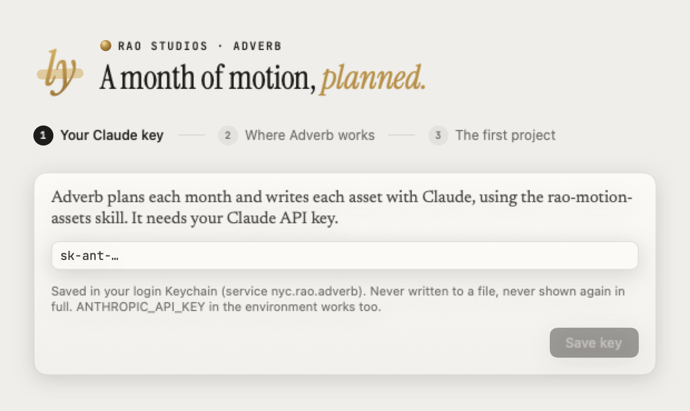
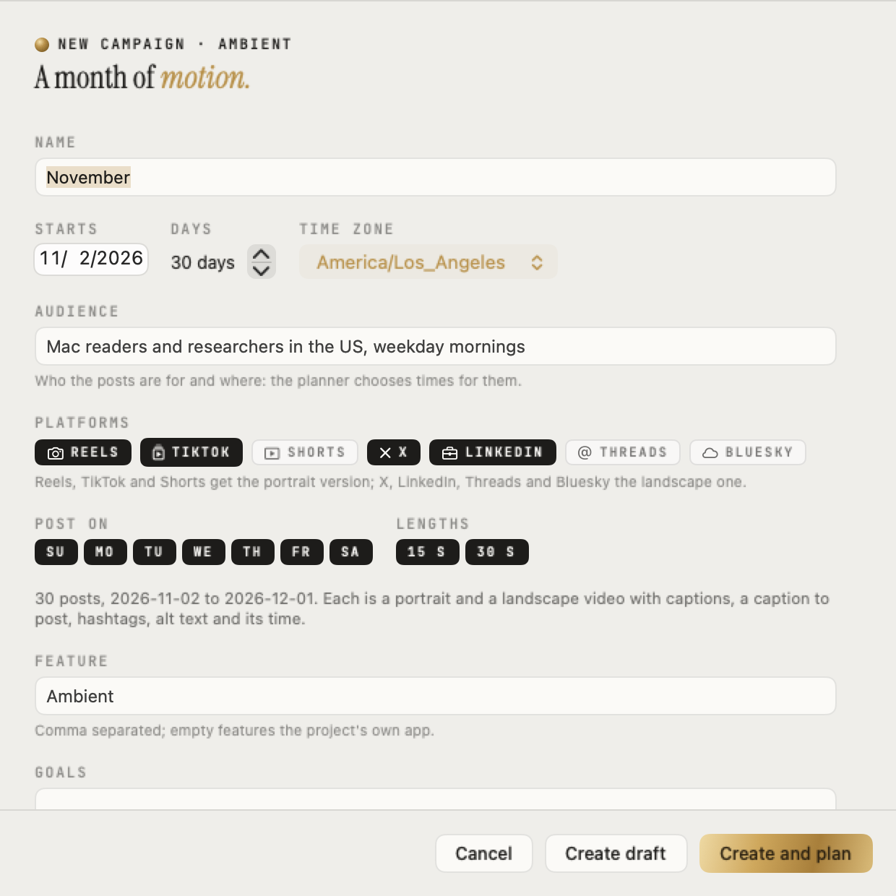
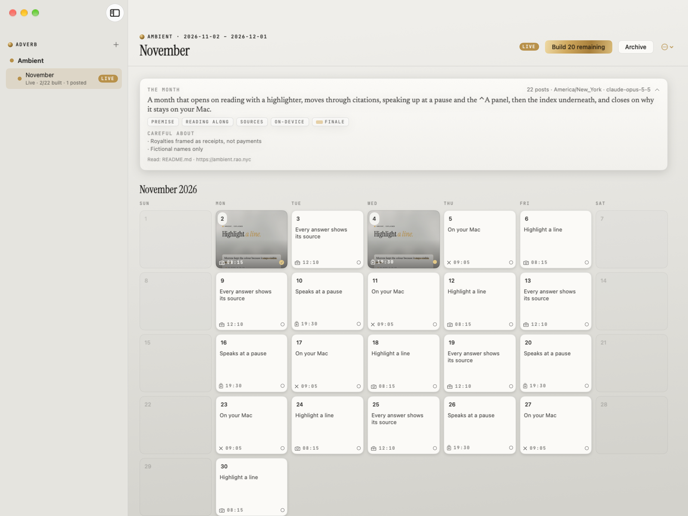
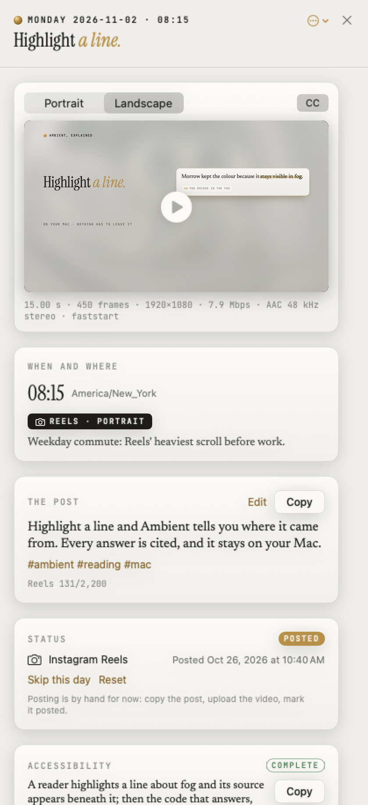
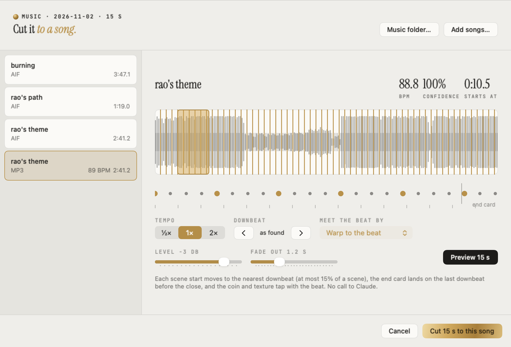
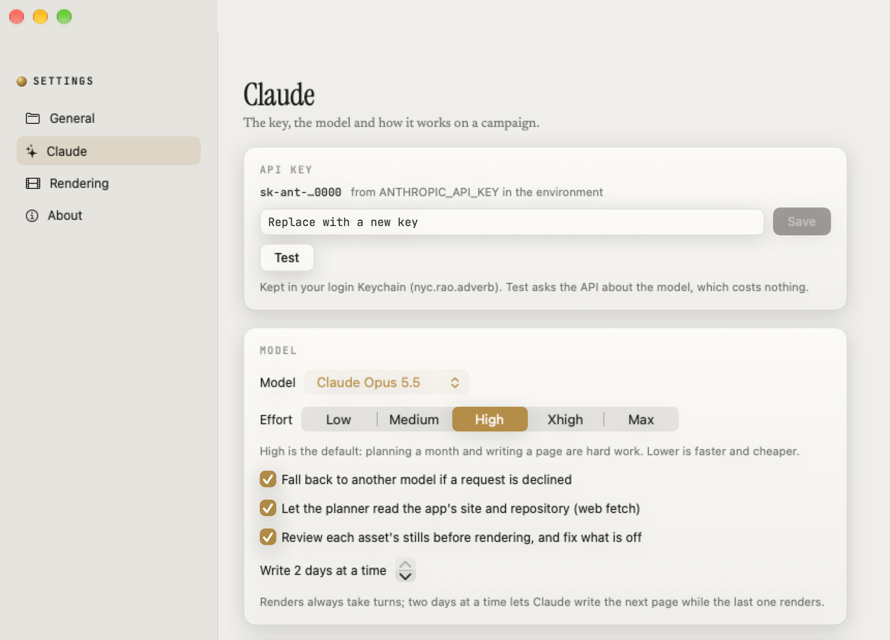

[](Docs/README_Assets/hero.png)

# Adverb — a month of motion

Adverb is a Mac app that turns a project you already work in into a month of social posts. Claude
plans the month with Rao's [motion-assets skill](Sources/AdverbCore/Resources/Prompts/SKILL.md);
Adverb renders every day's asset on your Mac in portrait and landscape, with captions, and lays the
month out on a calendar you post from.

You need a Mac with Apple silicon and macOS 26, and a Claude API key.

```sh
Scripts/make-app.sh && open build/Adverb.app     # or Scripts/dev.sh to build and run
```

## 1. Set up

The first launch asks for three things: your **Claude API key** (kept in your Keychain), a
**working directory** (Adverb keeps everything it makes in an `Adverb` folder there; an external
drive like the T9 works), and a **first project**: a folder you already work in, which Adverb reads
for context and never changes.

<p align="center"></p>

## 2. Plan a month

**New campaign** asks for the brief: when it starts, the audience, the platforms, which days to
post and how long the videos run. **Create and plan** sends it to Claude, which reads the project
and plans one asset per posting day, each with a caption, hashtags, a platform, and the time to
post with the reason for it.

<p align="center"></p>

## 3. Build it and follow the calendar

**Build the month** writes and renders every day, two at a time. Built days show a still in
the calendar; the rest show their topic. **Go live** marks the month you're posting and exports it
as a captions sheet, a CSV and a calendar file with an alarm at each post time. A project has one
live campaign at a time.



## 4. Post a day

Click a day. Play it in either orientation with captions on, see when and where it goes and why,
copy the post, and **Mark posted** once it's up. Every day also ships closed captions (WebVTT and
SRT), a descriptions track, alt text and a transcript; **Accessibility** has them and their checks.

<p align="center"></p>

## 5. Cut a day to a song

**Cut to a song…** opens your music folder. Pick a song, drag where it starts (it snaps to the
downbeats), preview it, and apply. Each scene moves onto a downbeat, the song goes under both
videos, and the silent original is kept: **Back to the silent original** restores it.



## 6. Settings

**General** holds the working directory and music folder, **Claude** the key, model and effort,
**Rendering** the video quality and renderer. The native renderer needs nothing installed; the
optional Chrome renderer needs Python with Playwright, and Settings checks for it.



## Where things live

| What | Where |
| --- | --- |
| Projects, campaigns, videos, captions, logs | `<working directory>/Adverb/<project>/` |
| Settings | `~/.rao/apps/adverb/settings.json` |
| API key | Keychain, `nyc.rao.adverb` |

Removing a project asks first and lets you keep its Adverb folder. The folder it reads is never
touched.

## For developers

`Scripts/test.sh` runs every suite. `swift run adverb-render-probe` renders a page, reads a song's
beats or inspects a video without the app. `Docs/README_Assets/src/build.sh` rebuilds the hero and
the icon. The app is built on [Granite](https://github.com/riteshpakala/Granite) in Craft's shape,
with Claude's work running as Craft's `@Agent`s. Apache-2.0 (see [LICENSE](LICENSE)).

> *"The road to hell is paved with adverbs."* — Stephen King
