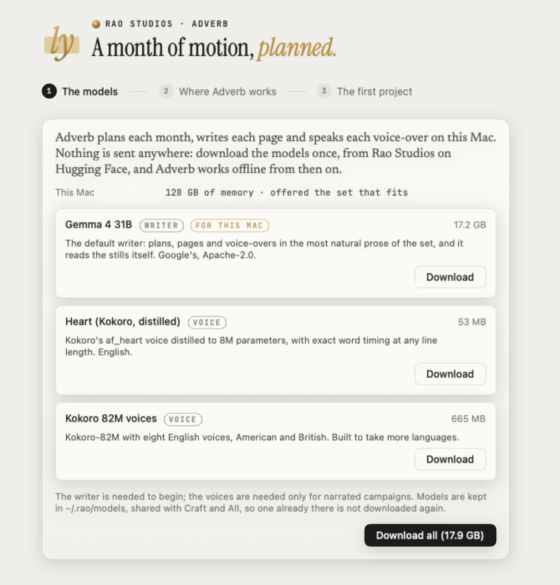
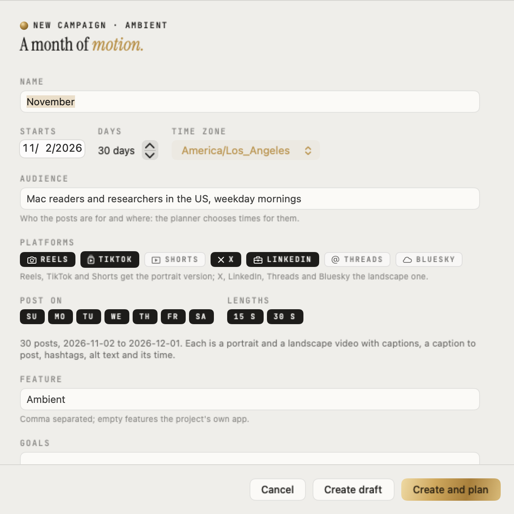
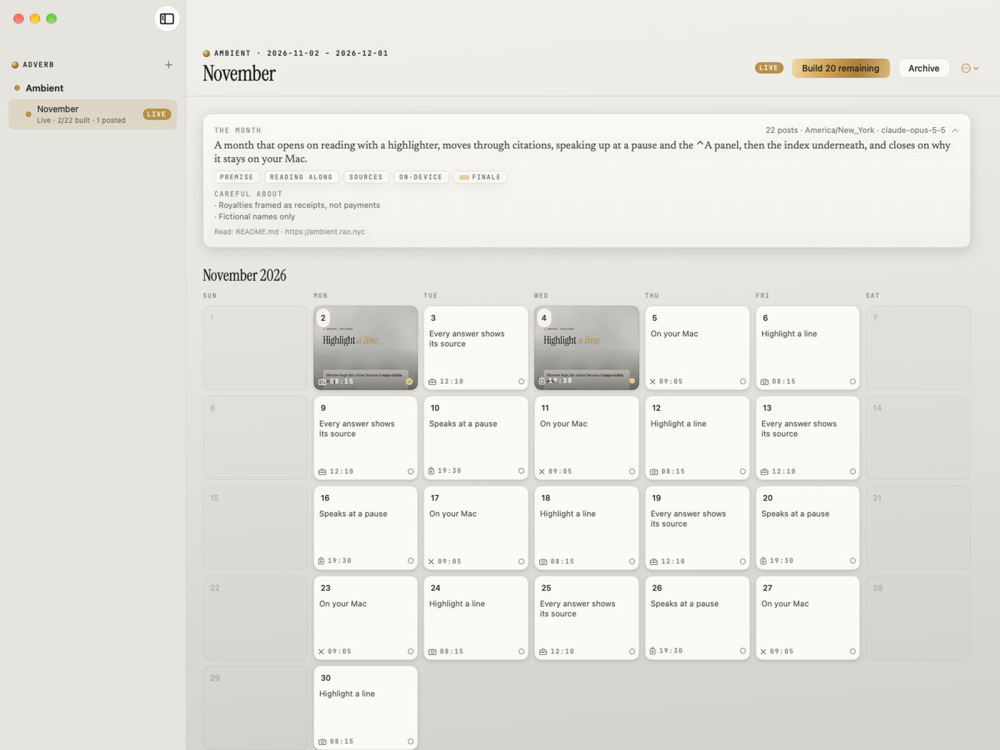
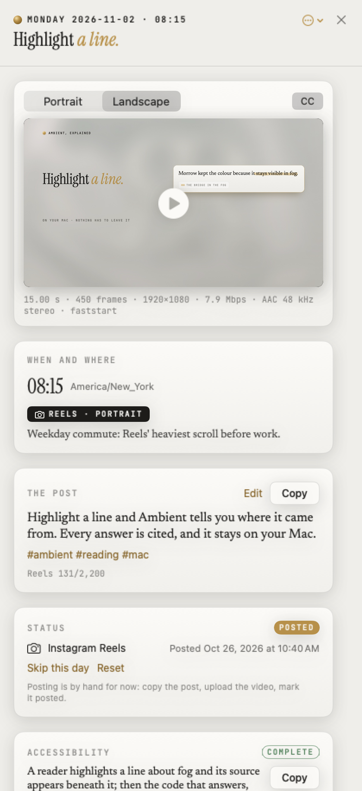
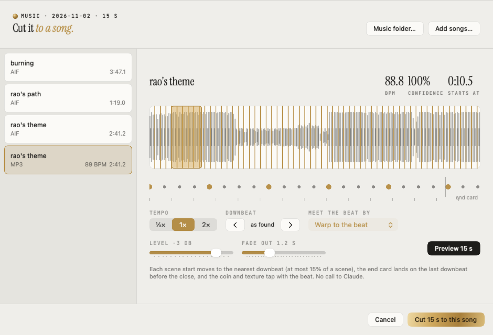
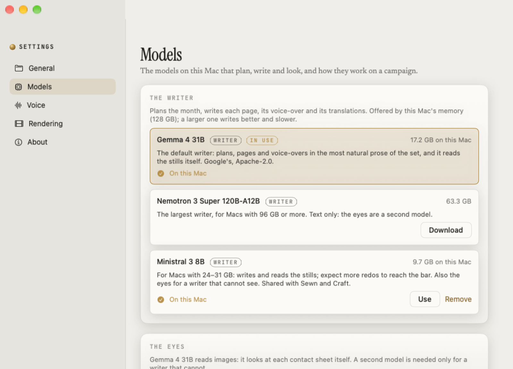

[](Docs/README_Assets/hero.png)

# Adverb — a month of motion

Adverb is a Mac app that turns a project you already work in into a month of social posts. A
model on your Mac plans the month with Rao's [motion-assets skill](Sources/AdverbCore/Resources/Prompts/SKILL.md),
writes each day's page and draws its contact sheet for you to look at; Adverb then renders every
approved day in portrait and landscape, with captions and a voice spoken on your Mac, and lays the
month out on a calendar you post from. Nothing is sent anywhere: no API, no key, no account.

You need a Mac with Apple silicon and macOS 26, and room for the models: about 17 GB for the
writer and 0.7 GB for the voices, downloaded once from [Rao Studios on Hugging Face](https://huggingface.co/rao-studios).
32 GB of memory runs the default writer; 24 GB runs a smaller one.

```sh
Scripts/make-app.sh && open build/Adverb.app     # or Scripts/dev.sh to build and run
```

## 1. Set up

The first launch asks for three things: **the models** (the set that fits your Mac's memory, each
downloaded once at a pinned commit; a model Craft or AII already fetched is used where it is), a
**working directory** (Adverb keeps everything it makes in an `Adverb` folder there; an external
drive like the T9 works), and a **first project**: a folder you already work in, which Adverb reads
for context and never changes.

| Model | What it does | Size |
| --- | --- | --- |
| [Gemma 4 31B](https://huggingface.co/rao-studios/gemma-4-31b-it-mlx-4bit) (MLX, 4-bit) | The writer: plans the month, writes each page, its voice-over and translations, and looks at each contact sheet | 17 GB |
| [Heart, Kokoro distilled](https://huggingface.co/rao-studios/kokoro-paradee-8m-coreml) (Core ML) | The default voice: Kokoro's `af_heart` in 8M parameters, exact word timing | 56 MB |
| [Kokoro 82M voices](https://huggingface.co/rao-studios/kokoro-82m-coreml-en) (Core ML) | Eight more English voices, American and British | 0.7 GB |

On a Mac with 24–31 GB the writer is [Ministral 3 8B](https://huggingface.co/rao-studios/Ministral-3-8B-Instruct-2512-mlx-8bit).
Settings › Models also offers [Nemotron 3 Super 120B](https://huggingface.co/rao-studios/NVIDIA-Nemotron-3-Super-120B-A12B-mlx-4bit),
for Macs with 96 GB or more.

<p align="center"></p>

## 2. Plan a month

**New campaign** asks for the brief: when it starts, the audience, the platforms, which days to
post and how long the videos run. **Create and plan** hands it to the writer on your Mac, which
reads the project and plans one asset per posting day, each with a caption, hashtags, a platform,
and the time to post with the reason for it. Switch on **Voice-over** to narrate every asset: hear
the voices on your Mac and pick one.

<p align="center"></p>

## 3. The sheets, then the videos

**Write the sheets** writes every day to its contact sheet, two at a time: the writer writes the
page, Adverb checks it (and sends back what breaks the contract, twice at most), speaks its
voice-over, takes stills of both orientations at 18, 42, 66 and 97 % and draws them into one sheet,
the way rao-motion-assets' sheets look. The writer then looks at its own sheet and fixes what it
sees. Each day waits there, its sheet in the calendar, until you look: **Approve** it, or **Send
back** with a note ("the code card runs off the right edge in portrait") and the page is changed to
do it. **Render N approved** makes the videos. Turn off **Stop each day at its contact sheet** in
Settings › Models to render each day as soon as its sheet passes its checks. While a day is written,
its card shows the page as the model types it.

In a narrated campaign Adverb times when each piece of text arrives on screen, the writer writes
the voice-over line by line to that text, and the voice on your Mac speaks it, reporting when each
word is said. The page then plays at the voice's pace, with the same warp a song cut uses: each
line's text arrives on its first word, and a scene that needs longer for its line stretches to give
it room. The captions carry what the voice says. If the voice step fails, the day is written silent
and says why. To narrate a campaign made without a voice, choose **Turn on voice-over…** in its
menu; days already rendered can be narrated in the same step, or later with **Voice N built days**
in the campaign's bar, without writing them again. **Go live** marks the month you're posting and
exports it as a captions sheet, a CSV and a calendar file with an alarm at each post time. A project
has one live campaign at a time.



## 4. Post a day

Click a day. Play it in either orientation with captions on, see when and where it goes and why,
copy the post, and **Mark posted** once it's up. Every day also ships closed captions (WebVTT and
SRT), a descriptions track, alt text and a transcript; **Accessibility** has them and their checks.

The **Voice-over** card lists the narration line by line, each with a play button. **Add a
voice-over…** narrates a day that was built silent, and **Another voice…** swaps the voice,
rendering the page again only if the new voice needs different timing. Once you've listened,
**Confirm English**: then choose the languages and **Generate**. The writer translates the lines and
the voice speaks them, and each language gets its own videos, captions and transcript from the
English frames, each line starting where its English one does. The voices on your Mac speak English
today; a language becomes available as soon as a voice pack for it is added (the packs are built to
take more). A song cut on a narrated day follows the voice: each line, and the text with it, lands
on the nearest beat, the song ducks under the voice, and every language is re-mixed.

<p align="center"></p>

## 5. Cut a day to a song

**Cut to a song…** opens your music folder. Pick a song, drag where it starts (it snaps to the
downbeats), preview it, and apply. Each scene moves onto a downbeat, the song goes under both
videos, and the silent original is kept: **Back to the silent original** restores it.



## 6. Settings

Open Settings with the **Settings** button at the foot of the sidebar, or ⌘,.
**General** holds the working directory and music folder; **Models** the writer (and the eyes, for a
writer that cannot read images), each downloaded or removed there, whether the writer thinks before
it writes, the review of each sheet and the sheet gate; **Voice** the voice packs, whether new
campaigns are narrated, the default voice (press play to hear it, spoken on your Mac) and the
languages to generate; **Rendering** the video quality and renderer. The native renderer needs
nothing installed; the optional Chrome renderer needs Python with Playwright, and Settings checks
for it.



## Time sheet

Everything runs on your Mac, so a run costs time, not money. A rolling log of how long, newest
first: add a row each time you log a run. Each run's log (`logs/`) ends with its tokens, speed and
time; `adverb-model-probe` times a step without the app.

| Date | What | Mac | Writer | Read / written (tokens) | Time |
| --- | --- | --- | --- | --- | --- |
| 2026-11-08 | One narrated 15 s day (Ambient) to its sheet, reviewed and fixed once, then both videos; GPU shared with other work | M4 Max, 128 GB | Gemma 4 31B, 4-bit | 140,402 read (89,154 from cache) / 4,462 | 25 min to the sheet, 27 min in all |
| 2026-11-08 | One 15 s day (Ambient) to its page, GPU shared with other work | M4 Max, 128 GB | Qwen3.8 27B, 4-bit | 29,480 / 2,636 | 30 min for the page |

The first call of a campaign reads the skill and the project (about 30,000 tokens); every call after
it reads only its own request, because the writer keeps the shared part in its cache. Writing is
most of the time: a 15 s page is about 2,000 tokens, a 30 s one more. The times above were taken
while other apps held the GPU, so a quiet Mac is faster. Thinking first (Settings › Models) makes a
better page and a slower one.

## Where things live

| What | Where |
| --- | --- |
| Projects, campaigns, videos, captions, logs | `<working directory>/Adverb/<project>/` |
| A day's contact sheet and stills | `<asset>/sheet.jpg`, `<asset>/stills/` |
| Settings | `~/.rao/apps/adverb/settings.json` |
| Models and voice packs | `~/.rao/models/huggingface/snapshots/models/rao-studios/` (shared with Craft and AII) |
| A day's narration | `<asset>/voice/<language>/` (`script.json` and one WAV clip per line) |
| Voice previews | `~/Library/Caches/nyc.rao.adverb/voices/` (spoken on your Mac once) |

Removing a project asks first and lets you keep its Adverb folder. The folder it reads is never
touched.

## For developers

`Scripts/test.sh` runs every suite. `swift run adverb-render-probe` renders a page, reads a song's
beats or inspects a video without the app. `adverb-model-probe` runs the generative steps headless:
an answer, a plan, a day to its sheet (and render), a line spoken; it is how models are compared
(Docs/ON-DEVICE.md). `Docs/README_Assets/src/build.sh` rebuilds the hero and the icon. The app is
built on [Granite](https://github.com/riteshpakala/Granite) in Craft's shape, with the models' work
running as Craft's `@Agent`s: the writer and the eyes on MLX through
[Frigate](https://github.com/rao-studios/Frigate), the voice on Core ML (Kokoro, lifted from
Ambient). `Scripts/release/mirror-model.py` and `mirror-voice-pack.py` publish a model to
rao-studios after a safety pass. MLX needs `mlx.metallib` beside the binary:
`Scripts/build-metallib.sh` puts it there (dev.sh, test.sh and make-app.sh run it). Apache-2.0
(see [LICENSE](LICENSE)).

> *"The road to hell is paved with adverbs."* — Stephen King
